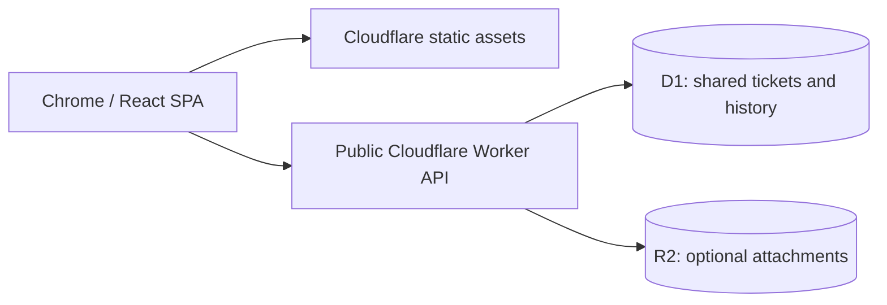

# Digital Platform Ticket Portal

A public full-stack ticketing workspace with a status workboard, cumulative SLA tracking, and an activity history. Built with React, TypeScript, Cloudflare Workers, D1, and optional R2 storage.

**Live app:** [digital-ticket-portal.billytamaputra.workers.dev](https://digital-ticket-portal.billytamaputra.workers.dev) · **Hosting:** Cloudflare Workers Free + D1 Free.

Anyone can view, create, and update tickets without an account. All tickets are shared with all visitors; use information appropriate for public access. File upload is disabled until optional R2 is activated.


## Features

- Dashboard, five latest status updates, search/date filters (WIB), CSV export.
- Four-column workboard: **Not started → In progress → Completed / CANCEL**.
- Larger, responsive typography: 16px form inputs, readable labels and tables, bigger buttons.
- Atomic status updates with optimistic concurrency: stale versions receive HTTP 409.
- Persisted SLA timestamps and accumulated duration per status. Closing a tab does not stop SLA; Completed/CANCEL stop active timers. Reopening resumes accumulated time without counting closed intervals.
- Priority targets: High 1h response / 4h work; Medium 4h / 24h; Low 8h / 48h. Calculated 24/7.
- Optional attachments/evidence through R2, 5 MB/file. Uploaded files are public through the portal when R2 is enabled.
- Same-origin write checks, server validation, and no admin login or session requirement.

## Architecture



Frontend is built as static assets; Worker runs API requests only. Ticket data is persisted in D1 and shared across visitors. No synthetic demo records are substituted for the database.

## Local quick start

Node.js 24 LTS:

```sh
npm ci
cp wrangler.example.jsonc wrangler.local.jsonc
npm run build
npm run db:local
npm run dev
```

Open the localhost URL printed by Wrangler. No password or secrets are required. The local database starts empty.

## Checks

```sh
npm test
npm run typecheck
npm run build
```

With the local Worker running, run `npm run test:api`. It creates local test tickets and refuses non-loopback targets.

## Hosting and migration

- [Free-plan Cloudflare deployment](docs/HOSTING.md)
- [Moving existing tickets and attachments](docs/MIGRATION.md)
- [GitHub portfolio setup](docs/PORTFOLIO.md)

Deployment requires a Cloudflare account and Wrangler login. Default hosting uses Workers Free + D1 Free and the included `workers.dev` URL. R2 is optional, requires separate activation, and can incur charges above its free allowance. Free quotas apply; production usage has not been load-tested.

## Limitations

Public collaboration has no per-user ownership or access control. SLA uses 24/7 time (no holidays/business hours). No email notifications or assignees. Data polling runs every 15s and currently reads the full ticket/history dataset; larger deployments need pagination. Previously applied authentication migrations are retained for database migration compatibility, but authentication tables are no longer used by the application.

## License

[MIT](LICENSE)
