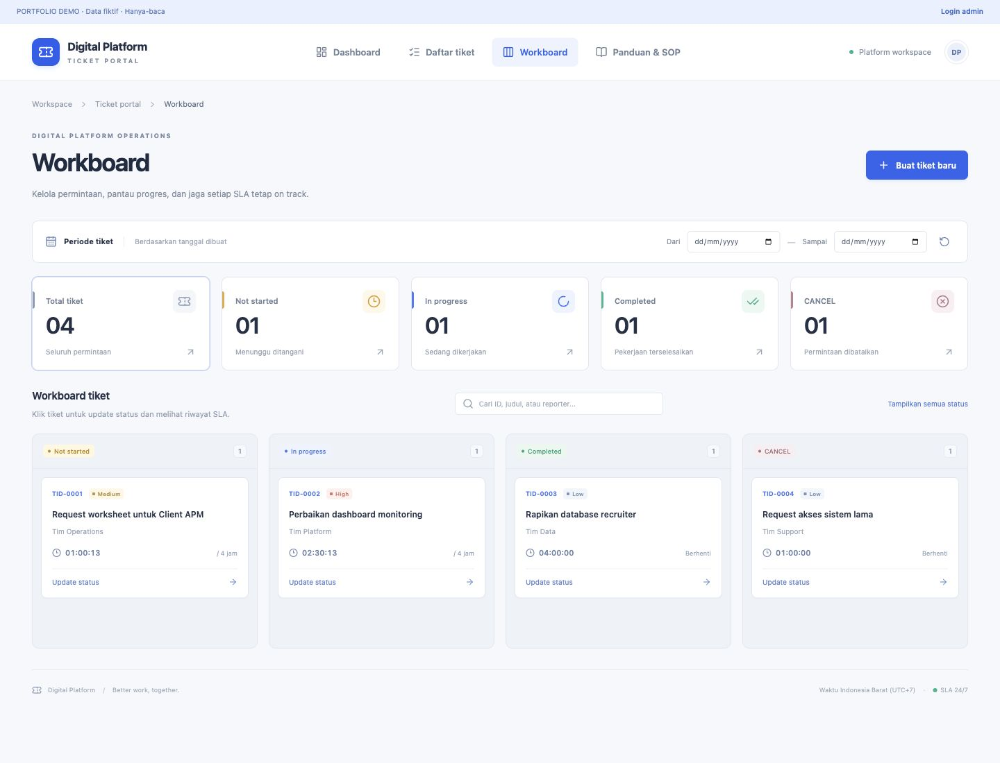
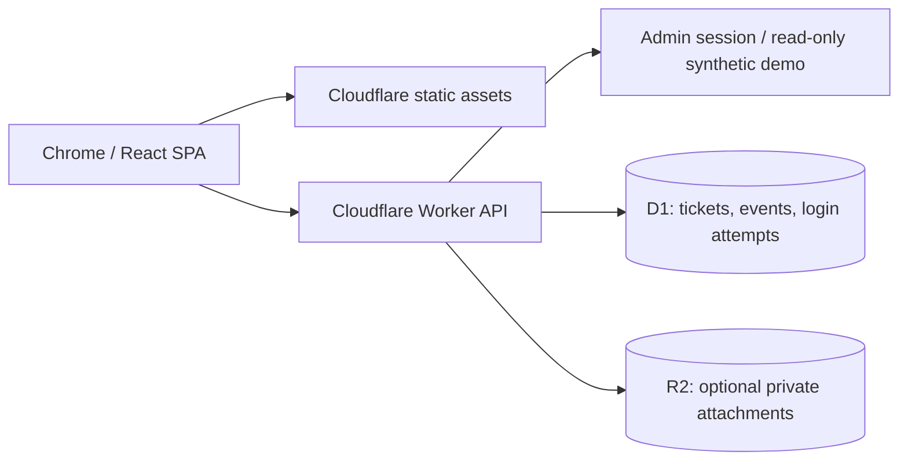

# Digital Platform Ticket Portal

A full-stack ticketing portal with a status workboard, cumulative SLA tracking, and an immutable activity history. Built with React, TypeScript, Cloudflare Workers, D1, and optional R2 storage.



**Live demo:** [digital-ticket-portal.billytamaputra.workers.dev](https://digital-ticket-portal.billytamaputra.workers.dev) · **Hosting:** Cloudflare Workers Free + D1 Free.

Public visitors see synthetic read-only data. Actual tickets require the owner's admin login; file uploads are disabled until optional R2 is activated.

## Features

- Dashboard, five latest status updates, search/date filters (WIB), CSV export.
- Four-column workboard: **Not started → In progress → Completed / CANCEL**.
- Atomic status updates with optimistic concurrency: stale versions receive HTTP 409.
- Persistent SLA timestamps and accumulated time per status. Closing a tab does not stop SLA; Completed/CANCEL stop active timers. Reopening resumes accumulated time without counting closed intervals.
- Priority targets: High 1h response / 4h work; Medium 4h / 24h; Low 8h / 48h. Calculated 24/7.
- Optional attachments/evidence via private R2 bucket, 5 MB/file.
- Public **read-only synthetic demo** isolated from actual database records.
- Single-owner admin session: signed expiring HttpOnly cookies, same-origin write checks, login rate limiting. No ChatGPT account required.

## Architecture



Frontend is built as static assets; Worker runs API/auth only to reduce CPU usage on the Free plan. The app can run without R2; file upload is disabled until the bucket binding is configured.

## Local quick start

Node.js 24 LTS:

```sh
npm ci
cp wrangler.example.jsonc wrangler.local.jsonc
npm run build
npm run db:local
npm run dev
```

Open the localhost URL printed by Wrangler. Demo mode works immediately. Configure local `.dev.vars` for admin access, as described in [Hosting](docs/HOSTING.md).

## Checks

```sh
npm test
npm run typecheck
npm run build
```

With the local Worker running and local secrets set, run `npm run test:api`. This creates local test tickets and uses the local password from `.dev.vars`; it refuses non-loopback targets. Test data stays in the local DB.

## Hosting and migration

- [Free-plan Cloudflare deployment](docs/HOSTING.md)
- [Moving existing tickets and attachments](docs/MIGRATION.md)
- [GitHub portfolio setup](docs/PORTFOLIO.md)

Deployment requires a Cloudflare account and login. Default hosting uses Workers Free + D1 Free and the included `workers.dev` URL; no custom domain is required. R2 is optional, requires separate activation, and can incur charges above its free allowance. Free quotas and CPU limits apply; production usage has not been load-tested.

## Limitations

Single-owner admin (no multiuser roles), 24/7 SLA (no holidays/business hours), no email notifications or assignees, polling every 15s and full ticket/history reads (pagination needed for larger datasets). Admin mode is for a small private workspace; a public portfolio should expose only the synthetic read-only demo.

## License

[MIT](LICENSE)
